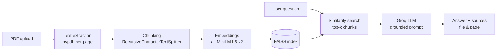

# Course Notes QA Assistant (RAG)

A **Retrieval-Augmented Generation** app that answers questions about your own course-note PDFs. It retrieves the most relevant passages with semantic search and has an LLM answer **only from those passages**, showing the source file and page for every answer.


## Features

- Upload one or more PDFs and build a vector index in one click.
- Grounded answers: the model is told to use only the retrieved context and to reply *"I don't know based on the provided notes"* when the answer is not there.
- Source transparency: every answer lists the retrieved chunks with **file name and page number**.
- Tunable RAG settings from the sidebar: model, temperature, top-k, chunk size and overlap.
- Switch between 8 Groq-hosted models (Llama 3.1 8B / 3.3 70B, Qwen3 32B, Kimi K2, GPT-OSS 20B / 120B, Groq Compound).

## How It Works



1. **Ingest** – `pypdf` extracts text page by page and keeps the file name and page number as metadata.
2. **Chunk** – `RecursiveCharacterTextSplitter` splits pages into overlapping chunks (default 1,000 characters, 150 overlap).
3. **Embed & index** – `sentence-transformers/all-MiniLM-L6-v2` embeddings stored in an in-memory FAISS index (the embedding model is cached across reruns).
4. **Retrieve** – the question is embedded and the top-k most similar chunks are retrieved (default k = 3).
5. **Generate** – the chunks and the question go to the selected Groq model with a strict grounding prompt (default temperature 0.2).

## Quick Start

```bash
git clone https://github.com/bssam99/Course-Notes-QA-Assistant.git
cd Course-Notes-QA-Assistant
pip install -r requirements.txt
python -m streamlit run app.py
```

Then, in the browser:

1. Paste your [Groq API key](https://console.groq.com/keys) in the sidebar (it is not stored).
2. Upload your PDFs and click **Understand Docs**.
3. Ask a question and click **Get Answer**.

## Configuration

| Setting | Default | Range |
|---|---|---|
| Model | `llama-3.1-8b-instant` | 8 Groq models |
| Temperature | 0.2 | 0.0 – 1.0 |
| Top-k chunks | 3 | 1 – 8 |
| Chunk size (characters) | 1000 | 400 – 2000 |
| Chunk overlap (characters) | 150 | 0 – 400 |

## Limitations & Roadmap

| Current limitation | Planned improvement |
|---|---|
| Scanned PDFs have no text layer | OCR (e.g. Tesseract) for image-only pages |
| Index lives only in the session | Persistent vector store |
| Pure semantic retrieval | Hybrid BM25 + vector search and a cross-encoder reranker |
| No conversation memory | Multi-turn chat history |
| No quality measurement | RAG evaluation (faithfulness, answer relevancy) |

## Tech Stack

`Python` · `Streamlit` · `LangChain` · `pypdf` · `Sentence-Transformers` · `FAISS` · `Groq API`

## Project Structure

```text
├── app.py             # Streamlit UI + RAG pipeline
├── requirements.txt
├── LICENSE
└── README.md
```

## Author

**Bassam Ahmed** · [LinkedIn](https://www.linkedin.com/in/bssam-ahmed) · [GitHub](https://github.com/bssam99)
